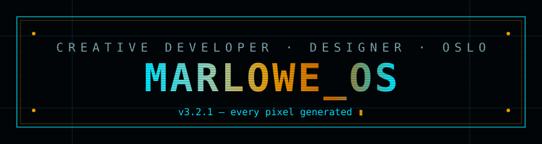
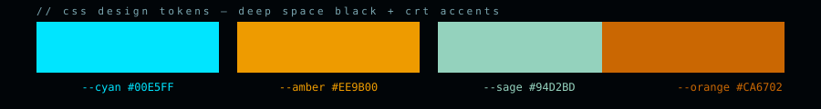
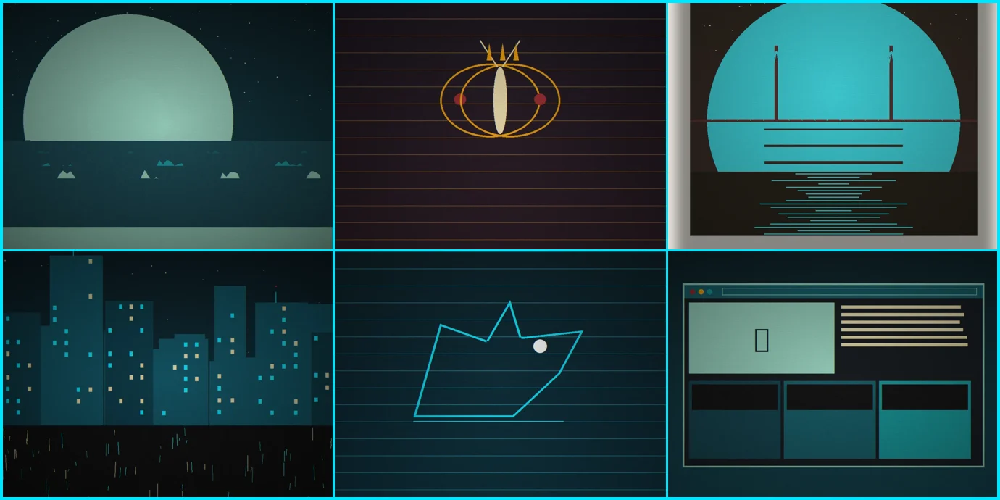

<div align="center">



[](https://pages.github.com/)
[](LICENSE)
[](#)
[](llms.txt)



</div>


## ◈ What is this?

A **single-page terminal-aesthetic portfolio** — boot-sequence preloader, glitch hero, custom
cursor, bilingual copy, synthesized UI sounds, and a fully procedural image archive. It looks
hand-coded because it is: **no framework, no build step, no stock photos.** Drop the folder on
any static host and it just works.

> The persona _Alex Marlowe_ is fictional — this is a ready-to-skin portfolio template.
> Swap the data, regenerate the art, ship it as yours.


## ◈ Feature map

| Zone           | What happens there                                                                                                                                   |
| -------------- | ---------------------------------------------------------------------------------------------------------------------------------------------------- |
| `BOOT`         | Terminal preloader — typed boot log, glitch bursts, progress, skip key                                                                               |
| `HERO`         | Scramble-reveal name, outlined glitch role, availability pulse, how-to panel, double marquee tickers                                                 |
| `ABOUT`        | Bio + Vignelli quote, live binary stream, ghost-word kinetics, 9-item certificate slider + lightbox                                                  |
| `WORK`         | Drawer panel with discipline tabs _(identity / editorial / web)_, project table, preview frame, **black-hole 404 easter egg** on lost files          |
| `PHOTO`        | 4-chapter accordion (52 frames), metadata typewriter terminal, 10-polaroid carousel, `REVEAL·SYS` hover-to-develop module                            |
| `ILLUSTRATION` | Auto-scrolling contact sheet + **holo-cube gallery** — 12 works on 4 rotating 3D faces, Back/Next + arrows, expand view                              |
| `CONTACT`      | Terminal form, hold-to-verify human gate, `READY ▸ TRANSMITTING ▸ ✓ SENT` state machine, canvas confetti, animated DNA capsule, rotating award badge |
| `GLOBAL`       | Custom dot+ring cursor with context labels · EN/ES switch · WebAudio sound engine · CRT scanline+grain overlay · `prefers-reduced-motion` support    |


## ◈ Stack — deliberately boring, deliberately fast

```
HTML5 · CSS3 (one file, custom properties) · vanilla JS (12 modules)
GSAP 3 + ScrambleTextPlugin   → text scramble + glitch motion
Splitting.js                  → per-character hero physics
ScrollOut                     → scroll-driven reveals
WebAudio API                  → synthesized UI sounds (zero audio files)
Python + Pillow               → generates the entire 105-image archive
Funnel Display (OFL)          → bundled locally, no CDN, works offline
```

Everything is vendored inside the repo — there are **zero external runtime dependencies**.




## ◈ The archive is code



All **105 images** (photos, polaroids, certificates, project mocks, illustrations, OG card)
are generated deterministically from one JSON file + one Python script — edit a seed, re-run,
get a new universe:

```bash
pip install pillow
python3 tools/generate_assets.py
# → rewrites assets/img/** and regenerates js/data.js
```


## ◈ File map

```
alex-marlowe-portfolio/
├── index.html                 # the whole site (single page)
├── 404.html                   # black-hole 404 page
├── css/
│   └── main.css               # design system — tokens, all sections, responsive, reduced-motion
├── js/
│   ├── lib/                   # gsap · ScrambleTextPlugin · splitting · scroll-out (vendored)
│   ├── data.js                # ← generated from tools/site_data.json
│   ├── fx.js                  # helpers: scramble, typewriter, marquee, seed rng
│   ├── i18n.js                # EN/ES dictionary + live switch
│   ├── audio-engine.js        # WebAudio synth UI sounds
│   ├── cursor.js              # custom cursor states
│   ├── preloader.js           # boot sequence
│   ├── hero.js · about.js · work.js · photo.js · illo.js · contact.js · app.js
├── assets/
│   ├── fonts/                 # Funnel Display woff2 + OFL license
│   ├── img/                   # 105 generated images (certs · projects · photos · polaroids · illustrations)
│   └── svg/favicon.svg
├── tools/
│   ├── site_data.json         # ← ALL content lives here (single source of truth)
│   └── generate_assets.py     # ← press this button
├── docs/asset-wall.webp       # used by this README
├── .github/readme/            # animated SVG components for this README
├── robots.txt · sitemap.xml · llms.txt
├── .gitignore · LICENSE
└── README.md
```


## ◈ Make it yours (5-minute path)

1. **Persona** — edit `tools/site_data.json` (name, titles, projects, photos, illustrations), then
   `python3 tools/generate_assets.py`.
2. **Copy** — UI text in `js/i18n.js` (EN + ES dictionaries), hero/about/contact text in `index.html`.
3. **Email** — search `hello@alexmarlowe.dev`, replace everywhere.
4. **Colors** — 8 CSS custom properties at the top of `css/main.css`.
5. **Real form** — in `js/contact.js`, replace the `sendReal()` demo promise with a `fetch()`
   POST to your endpoint (Formspree / Web3Forms / serverless function).


## ◈ Run locally · Deploy

```bash
# any static server works — no build step
cd alex-marlowe-portfolio
python3 -m http.server 8000
# open http://localhost:8000
```

<details><summary><b>Screenshots for social/OG</b></summary><br>
The OG share card is pre-generated at <code>assets/img/og-image.jpg</code> (1200×630) — update
it by editing the OG block in <code>tools/generate_assets.py</code>.
</details>

<details><summary><b>Why no framework?</b></summary><br>
Deliberately. The site ships ~250 KB of hand-inspectable code and every asset is local — it will
still work, unchanged, the next time a bundler ecosystem gaslights its changelog.
</details>


## ◈ Credits

| Piece                                 | License                             |
| ------------------------------------- | ----------------------------------- |
| Code & generated artwork in this repo | [MIT](LICENSE)                      |
| Funnel Display font                   | [SIL OFL 1.1](assets/fonts/OFL.txt) |
| GSAP + ScrambleTextPlugin             | GreenSock Standard License          |
| Splitting.js · ScrollOut              | MIT                                 |

<a href="https://www.buymeacoffee.com/" target="_blank" rel="noopener"></a>

<div align="center">

## 🌟 Support the Project

If you find this template useful, please consider giving it a star! It helps others discover the repository and supports future development.

</div>


